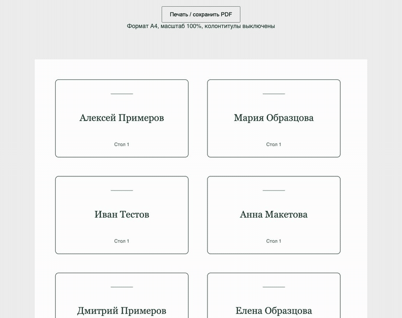

# Print Kit

Карточки гостей, номера столов и план рассадки из одного списка CSV, JSON или Excel.

Автор: [Марк / MDRK Studio](https://mdrkstudio.ru).

<picture>
  <source media="(prefers-reduced-motion: no-preference)" srcset="docs/demo.gif">
  
</picture>

## Запуск

Python 3.10+, для CSV и JSON дополнительных пакетов не нужно:

```bash
python3 -m printkit examples/guests.csv --output output --title "Встреча MDRK"
```

Или установи CLI:

```bash
python3 -m pip install .
print-kit examples/guests.json --output output
```

Для Excel:

```bash
python3 -m pip install ".[xlsx]"
print-kit guests.xlsx --sheet Guests --output output
```

## Входные данные

Столбцы `name` и `table` либо `имя` и `стол`. Одна строка - один человек. Имя указывайте целиком, автоматического изменения фамилий нет. CSV: UTF-8, разделитель запятая, точка с запятой или табуляция. JSON: массив объектов или объект с массивом `guests`. Excel: первый лист или лист из `--sheet`, первая строка содержит заголовки. Ячейки с формулами должны иметь сохранённые вычисленные значения.

```csv
name,table
Алексей Примеров,1
Мария Образцова,1
```

До 1000 гостей за запуск, до 100 символов в имени. Совпадение имени и стола считается повтором и требует исправления списка.

## Результат

- `cards.html` и `cards/`: карточки 90 x 55 мм, восемь на A4, отдельные SVG.
- `tables.html` и `tables/`: номера столов 90 x 120 мм, четыре на A4, отдельные SVG.
- `seating.html`: рассадка по столам, с переносом на следующие страницы.
- `summary.json`: число гостей и список столов.

Открой HTML в браузере, нажми «Печать / сохранить PDF». Выбери A4, масштаб 100%, выключи колонтитулы. Шрифты системные, поэтому вид может немного отличаться между компьютерами. При печати SVG проверяй сохранение размера 100%.

```bash
print-kit examples/guests.csv --format cards --output cards-output
print-kit examples/guests.csv --format tables --output tables-output
print-kit examples/guests.csv --format seating --output seating-output
```

Папка вывода должна быть новой или пустой. Файлы существующего проекта не перезаписываются. Имена гостей не используются как имена файлов. Все операции выполняются на компьютере, загрузки данных во внешние сервисы нет.

## Лицензия

Авторский код - [PolyForm Noncommercial 1.0.0](LICENSE). Некоммерческое использование, изменения и распространение разрешены по её условиям. Сохраняйте LICENSE и [NOTICE](NOTICE).

Для коммерческого применения нужно разрешение [MDRK Studio](https://mdrkstudio.ru/contacts). Сторонние зависимости и ресурсы сохраняют собственные лицензии.
